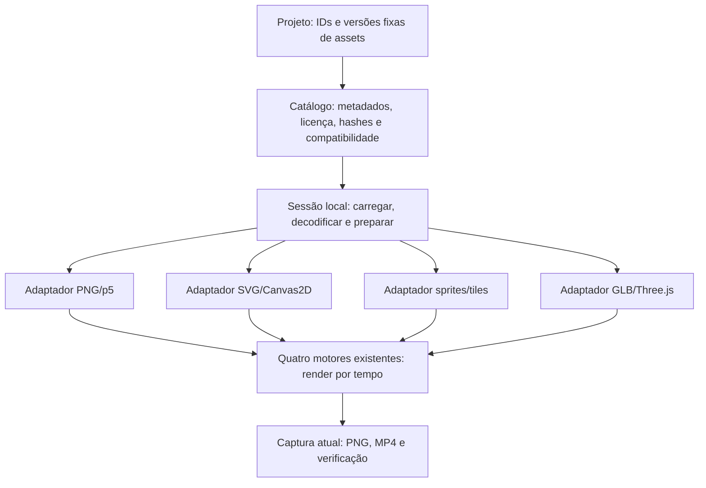

# Evolução artística dos quatro motores — auditoria e plano

Atualização em 22/10/2026: a etapa de [PNG em camadas para aquarela](WATERCOLOR_ASSET_ACTOR_REPORT.md) foi autorizada separadamente e tem relatório próprio. As afirmações históricas abaixo de ausência de adaptadores 2D não descrevem esse incremento. O perfil procedural, os packs e a entrega 3D foram preservados. SVG/cartoon, atlas/pixel e compilador JSON continuam fora desta etapa.

21/10/2026, horário de São Paulo. **Documento para revisão; implementação não iniciada.** Não inclui compilador de storyboard JSON, geração automática por prompt, aquisição de recursos, dependências novas ou novos renders.

**Atualização autorizada:** o usuário aprovou a implementação incremental de infraestrutura comum e um piloto 3D estático, após acrescentar a seção 15. A ordem/escopo da seção 16 prevalecem sobre a sequência abrangente da seção 13. As descrições de auditoria acima/abaixo preservam o estado anterior; resultados de implementação serão registrados em relatório próprio.

Recomendação: acrescentar um catálogo de assets e quatro adaptadores pequenos, mantendo os backends, o contrato `animationEngine`, a timeline, a captura e a verificação existentes. O ganho visual depende tanto de arte preparada para animação quanto de importação. Mais curvas, polígonos ou efeitos, isoladamente, não garantem acabamento profissional.

## 1. Evidências examinadas

Foram lidos `AGENTS.md`, `ANIMATION_GUIDE.md`, `ARCHITECTURE.md`, os quatro guias, `src/platform.js`, `runtime.js`, `loader.js`, `timeline.js`, `config.js`, `core.js`, construção de Clawd, os quatro motores, configurações pixel/3D, servidor, inventário/render-lib e relatórios de implementação/generalização 3D. Foram conferidos o código instalado de `GLTFLoader`, `AnimationMixer.setTime` e `Skeleton.dispose`, além da documentação oficial indicada nas seções seguintes.

Base documentada: revisão de produção `66fd1e9898025395092effec18fb8db9c0bb838e7fc7eb7eec8b323923ffa701`, quatro motores e duas histórias 3D. Os resultados anteriores de testes/desempenho pertencem àquela entrega; este planejamento não os apresenta como novos testes executados.

### Referências efetivamente abertas

| Arquivo | Leitura visual e implicação |
|---|---|
| [aquarela_2d.png](imgs/aquarela_2d.png) | Ilustração de aspecto digital pintado: rosto expressivo, cabelo/roupa detalhados, bordas controladas, cenário vegetal denso e profundidade atmosférica. A imagem não demonstra apenas pigmento de aquarela tradicional. Recomendo perfil ilustrado em camadas, além da aquarela procedural preservada. |
| [cartoon_vetorial.jpg](imgs/cartoon_vetorial.jpg) | Curvas orgânicas, cabelo em mechas, mãos, tecido, sombras suaves, luz de recorte e textura. É um JPEG: sua aparência não comprova que o original seja SVG. Vetores articulados e acabamento raster opcional são uma alternativa coerente. |
| [pixel_art.jpg](imgs/pixel_art.jpg) | Ambiente de jogo detalhado: materiais distinguíveis, agrupamentos de pixels, perspectiva elevada, vegetação, água e sombras consistentes. O JPEG não permite inferir uma paleta exata nem a resolução lógica original. Não deve virar spritesheet por redução/quantização automática. |
| [3d_estilizado_cinematografico.jpg](imgs/3d_estilizado_cinematografico.jpg) | Superfícies arredondadas, detalhes mecânicos, materiais com respostas distintas, emissão, iluminação de recorte e desfoque de fundo aparente. São indícios visuais; não identificam o renderizador ou a técnica de produção. O perfil low poly facetado atual não procura esse resultado. |

Também foram abertos os três `out/checks/*-contact.png` e o PNG central do filme anterior de Marte. Eles confirmam a distância visual em detalhe, modelagem, volume, materiais e densidade de cenário. São bases visuais existentes; nenhum quadro novo de qualidade foi produzido.

As quatro referências continuam apenas em `docs/imgs`, fora das rotas do estúdio. Não serão recortadas, vetorizadas, usadas como texturas, reconstruídas literalmente ou admitidas automaticamente no catálogo. Sua presença no workspace não comprova licença de produção.

Hashes SHA-256 das referências vistas:

| Arquivo | Hash |
|---|---|
| aquarela_2d.png | `ecd6eed9071c11d4d88e33a5cfca96c917b4649259189c45ce1b886f9c292b44` |
| cartoon_vetorial.jpg | `eb0ad69841854def7472a6aa2898965126df8a61aec73f43a54c7a46597eaff0` |
| pixel_art.jpg | `53cc71468cd002c31a5e8ac1b2c52c3253feee4d00e6b21ef6a64d0502b9c6a5` |
| 3d_estilizado_cinematografico.jpg | `85afa531603d39731435ee4989c4766cc9462a1526dc8ebdd4654b5c69ee53fa` |

## 2. Auditoria: capacidade atual e lacunas

| Motor | Por que parece simples | Suporte efetivo a assets no projeto | Capacidade da biblioteca subjacente |
|---|---|---|---|
| Aquarela | `clawd.js` define deliberadamente corpo retangular, pernas curtas, olhos em fenda e vistas desenhadas. O pincel já oferece pigmento, papel e contorno; não fornece anatomia ou design detalhado automaticamente. | Nenhum importador de ilustrações. Papel, grain e glow são gerados internamente. Já há composição de imagens/canvases internos e hooks de desenho no personagem. | p5 consegue carregar/desenhar imagens; isso ainda não foi transformado em fluxo de assets versionados para personagens. |
| Cartoon | `VisitArt` desenha retângulos, elipses e alguns Béziers com poucos detalhes. É uma demonstração artística, não uma limitação intrínseca do Canvas2D. | Nenhum importador SVG ou rig externo. `animationEngine.context` permite desenhar imagens depois de carregadas, mas a carga/validação não existe. | Canvas2D pode compor imagens e aplicar transformações; o navegador pode rasterizar SVG estático. |
| Pixel | O personagem é construído por blocos/segmentos, em 320×180, com dez cores distintas e poses em 12 desenhos/s. `quantize()` percorre o quadro e o força à paleta atual. | Nenhum leitor de spritesheets, frames, tilesets ou mapas em camadas. O buffer e contexto nativos estão expostos. | Canvas2D aceita recortes de atlas e escala sem suavização. |
| Low poly 3D | Primitivas com poucos segmentos, Lambert, flat shading, paleta sólida e luz básica são escolhas explícitas. O catálogo melhora reuso, não aumenta sozinho a sofisticação da arte. | Não há carregamento de GLB/glTF em nenhuma cena. GLTFLoader e seus imports já estão nas rotas permitidas, mas não são importados pelo filme. | Three.js instalado contém loader, materiais PBR, skinning, morph targets e mixer; essas capacidades ainda não estão integradas/testadas na plataforma. |

**Os quatro filmes atuais são procedurais. Nenhum dos quatro backends é inerentemente restrito a isso.** Distinguir disponibilidade da API, integração funcional e validação de qualidade evita anunciar suporte que ainda não existe.

Gargalos concretos encontrados:

- O servidor serve apenas studio, JS de `src` e dependências específicas, com MIME de HTML/JS. Não há rotas para PNG, SVG, JSON de assets, GLB, glTF ou BIN.
- O inventário de produção cobre código/dependências, não uma cadeia de arquivos de assets. Trocar uma textura hoje não tem um protocolo de cache/proveniência projetado para isso.
- `runtime.js` aguarda `animationEngine.init`, mas não dispõe de uma sessão comum de assets. O construtor `buildLowpolyScene` é síncrono; o motor o chama sem `await` e já desenha em 0. Carga assíncrona deve terminar antes dessa construção.
- Aquarela sinaliza prontidão em `setup`; importar partes precisa respeitar a criação do contexto e terminar antes do primeiro desenho que dependa delas. Também será necessário propagar falhas dessa preparação à Promise de init.
- `platform.js` aceita apenas chaves conhecidas nos overrides. Arrays são tratados como objetos no merge atual. Não colocar listas de partes, arquivos ou cores dentro de `styleOptions` esperando substituição normal de arrays.
- Pixel quantiza mesmo se o sprite já estiver corretamente desenhado. Uma paleta rica seria destruída pela paleta padrão. A suavização precisa ser desligada no buffer de importação, além do canvas de saída.
- O validador 3D rejeita `texture.bitmaps:true`, limita a 64 meshes/10 mil triângulos únicos e mantém `NoToneMapping`. O renderer é privado. Esses limites/opções precisam de extensão explícita por perfil, sem trocar os defaults.
- O descarte 3D atual atende os recursos procedurais e mapas de materiais. Não trata explicitamente mixers, esqueletos/bone textures ou futuros render targets de pós-processamento. Isso deve ser coberto antes de admitir personagens animados importados.

## 3. Arquitetura proposta

Manter os quatro IDs de estilo. Acrescentar perfis opcionais: aquarela ilustrada, cartoon articulado, pixel com atlas e 3D estilizado com assets. O perfil procedural de cada motor continua padrão, com seus snapshots e dimensões. Cada filme congela um único perfil/bíblia visual.



A camada comum cuida de IDs, arquivos, verificação, carregamento e ciclo de vida. Os adaptadores cuidam de desenho, rigs, frames e materiais. Ela não se torna outro motor ou editor de cenas. `motion.js` e `timeline.js` continuam sem regras artísticas.

### Inicialização e propriedade

1. Resolver projeto e validar `assetRefs` opcionais, fora do merge de `styleOptions`.
2. Carregar apenas os módulos de assets do estilo necessário. Projetos sem refs seguem o caminho atual.
3. Resolver o conjunto fechado de dependências, validar bytes e aguardar carga/decodificação. Dados do catálogo são imutáveis; ImageBitmaps, imagens p5, modelos e mixers vivem numa sessão mutável separada de `PROJECT`.
4. Iniciar o motor. A preparação que precisa do contexto acontece dentro de seu init, antes da primeira cena: p5 cria suas representações; 3D recebe o modelo já carregado e compila seus materiais.
5. Só liberar `ready` após todos os recursos obrigatórios e o primeiro quadro válido. Sem carregamento tardio em `render(t)` e sem substituir um asset que falhou por uma forma geométrica silenciosamente.
6. Cancelar a carga ao trocar de projeto, rejeitar timeout/arquivo corrompido e limpar recursos parciais. Descarte idempotente, inclusive em falha de init.

Uma pequena hierarquia de partes 2D pode atender aquarela e cartoon: parent, pivot, transformação local, ordem de desenho, visibilidade e anchors. Não propor IK geral, skinning 2D, solver ou retarget universal nesta primeira fase. Pixel compartilha metadados/anchors, mas escolhe desenhos discretos; não aplica deformação suave indiscriminadamente.

## 4. Extensão da aquarela

**Primeira escolha:** PNG RGBA em camadas, preparado artisticamente, com p5/brush preservados para ambientes e detalhes que se beneficiem deles. Expor desenho de partes pelo adaptador do estilo; não obrigar novas personagens a passar pela anatomia de `clawd()`.

O pack conterá corpo, cabeça, braços, mãos e cabelo/acessórios separados conforme a ação; pivôs, sobreposição escondida nas articulações e anchors de olhos/mãos/pés. Vistas frontal/3/4 e expressões precisam ser desenhadas com o mesmo modelo e escala. Virar uma ilustração plana não produz uma nova vista convincente.

Carregar bytes/decodificar antes do init; no ponto de preparação p5, construir representações compatíveis com `image()`. A biblioteca documenta os tipos de imagem aceitos, incluindo p5.Image/Graphics; não assumir que um ImageBitmap nativo possa ser passado diretamente ao WebGL de p5 sem adaptação. [Referência p5](https://p5js.org/reference/p5/image/).

O desenho entra na mesma ordem da cena: `flushBrush()` antes de uma imagem que precisa ficar sobre a tinta, transforms/câmera correntes, restauração de tint/blend e grain final já existente. Testar imagem → tinta → imagem → transição, transparência, premultiplicação e franjas claras. Evitar uma camada final única que cubra indevidamente props e wipes.

Textura de papel/pigmento deve vir da arte ou de uma composição controlada. Não duplicar grain forte sobre um PNG que já o contém, nem aplicar jitter geométrico a toda a ilustração a cada frame. Movimento de roupa/cabelo será analítico, por partes e desenhos substitutos; deformação ampla de rosto/membros exige arte adicional.

Alternativas:

| Opção | Benefício | Limite/custo |
|---|---|---|
| PNG por parte, recomendada | Preserva acabamento pintado, pouco custo de desenho após decode | Memória das camadas; juntas e rotações grandes precisam de preparação artística. |
| Poses completas em PNG | Melhor controle da silhueta em ações difíceis | Mais desenhos, memória e trabalho; pouca interpolação natural entre vistas. |
| Melhorar somente o procedural | Mantém liberdade de pincel e independência de arquivos | Muito código/arte manual para anatomia, cabelo, roupa e fundos complexos; custo de pintura por quadro continua. |

## 5. Extensão do cartoon

**Primeira escolha:** SVG estático por parte, ou pack exportado de um SVG com grupos/IDs deliberadamente preparados, mais um rig simples de pivôs/parentesco. Preservar caminhos, cores, gradientes e viewBox dos arquivos fonte. A importação não vai adivinhar anatomia a partir de uma ilustração achatada.

Na primeira versão, o navegador rasteriza cada parte aprovada uma vez na maior escala/zoom previstos, e Canvas2D transforma essas superfícies nos quadros. O fonte permanece SVG, mas o cache de reprodução é raster: fora da faixa de zoom prevista haverá perda de detalhe ou necessidade de recache antes da produção. Não anunciar essa opção como avaliação vetorial ilimitada por quadro. `drawImage` já é uma operação nativa do contexto existente. [Canvas2D](https://developer.mozilla.org/en-US/docs/Web/API/CanvasRenderingContext2D/drawImage).

Para um SVG único articulável, a preparação separa grupos com seus transforms/defs preservados; exigir uma convenção de exportação e recusar elementos não suportados. O caminho mais confiável para o piloto é exportar partes SVG explicitamente, sem implementar um interpretador universal de SVG/CSS.

Olhos, pálpebras, sobrancelhas e bocas serão partes/variantes nomeadas; poses devem evitar dupla face por crossfade. Mechas e tecidos precisam de segmentos sobrepostos, variantes e timing próprio. Girar braços rígidos não reproduz o fluxo do cabelo ou a anatomia da referência. Não usar relógio de CSS, SMIL, GIF ou animação DOM autônoma: todas as escolhas vêm de `t`.

Alternativa posterior: importar um subconjunto documentado de paths para `Path2D` e aplicar as matrizes da hierarquia no Canvas2D. Isso preserva escala vetorial para esse subconjunto, mas exige suporte correto a estilos, gradientes, clips, preenchimento e transforms. Fazer somente se o piloto revelar limite real no cache SVG. Um interpretador SVG completo ou biblioteca nova não é pré-requisito.

SVG é conteúdo estruturado: aceitar lista positiva de elementos/atributos e referências internas aprovadas; rejeitar scripts, eventos, foreignObject, entidades/DOCTYPE, CSS/imports/URLs externos, animações e filtros caros. Não inserir o SVG original via `innerHTML` na interface. DOMParser sozinho não é sanitizador. O modo SVG-como-imagem tem restrições próprias, mas elas não substituem a validação do pack. [SVG como imagem](https://developer.mozilla.org/en-US/docs/Web/SVG/Guides/SVG_as_an_image).

## 6. Extensão de pixel art

**Primeira escolha:** atlas PNG sem perdas + metadados de frames/tempos/anchors; tileset PNG + mapa de índices e camadas. O piloto não exige importar diretamente Aseprite, PSD ou formatos de editores: exportação para PNG/JSON normalizado é suficiente.

Cada frame declara retângulo, tamanho original, offset de recorte e ponto de apoio. Isso evita pés/rosto pulando quando desenhos têm bounds diferentes. A animação escolhe o frame por tempo absoluto e durações acumuladas, não por contador. Direções, idle, caminhada e gesto só constam como disponíveis se tiverem desenhos reais.

Manter 320×180 e escala 6 como defaults. Primeiro avaliar um pack mais detalhado nessa grade. Se a escala necessária para personagens/cenários exigir mais espaço, comparar **separadamente** um perfil 640×360, escala 3 para saída 1920×1080; o validador já permite esse divisor. Não aumentar a grade dos projetos antigos. Uma referência detalhada pode requerer essa decisão artística; não cabe prometer a mesma densidade em qualquer grade.

Paleta do pack é validada fora do objeto fixo de tokens legado. Em modo assets, usar uma paleta aprovada do projeto e rejeitar pixels incompatíveis, ou quantizar uma única vez na admissão com uma derivação revisada e versionada. Nunca remapear silenciosamente toda arte para as dez cores atuais. O modo procedural conserva exatamente seu caminho `quantize()`.

Desligar suavização em **todos** os contextos de importação/composição/escala; arredondar posições/câmera na grade, usar escalas inteiras e frames desenhados para viradas/rotações. Transparência de sprite em alpha 0/255, salvo exceção artística testada; antialias de uma fonte externa não vira pixel art correto por um filtro final. A saída opaca de vídeo é distinta da transparência dos assets. [Suavização Canvas](https://developer.mozilla.org/en-US/docs/Web/API/CanvasRenderingContext2D/imageSmoothingEnabled).

Tiles/cenários terão ordem estável, origem/base dos objetos e camadas de fundo, chão, props e primeiro plano. Renderizar sobreposições de personagens/props por uma regra explícita de base/profundidade, não só ordem de arquivos. Água, plantas e luzes usam ciclos de atlas com offsets estáveis. Composição isométrica/elevada será uma convenção do cenário, não conversão automática de uma imagem em tiles.

Alternativas: mapa de fundo inteiro com camadas é mais rápido de preparar, mas menos recombinável; tileset custa mais arte de bordas/variações, mas permite cenários reutilizáveis. Começar com fundo em camadas + pequeno tileset, em vez de um editor geral de mapas.

## 7. Extensão 3D estilizada

**Primeira escolha:** GLB glTF 2.0 autocontido, sem compressões que precisem de decoders extras. O mesmo pacote Three.js 0.186.1 já contém GLTFLoader/SkeletonUtils e as rotas necessárias para seu import inicial. Não instalar outra dependência nem atualizar Three.js para esse piloto. [GLTFLoader](https://threejs.org/docs/pages/GLTFLoader.html).

Carregar e validar o modelo antes de `buildLowpolyScene`. Inserir a hierarquia/material original, normalizando unidades, frente local +Z, escala, orientação e base dos pés conforme metadados. Não recriar todo material importado com `art.material()`, pois esse helper produz Lambert e descartaria a intenção PBR do asset.

O perfil novo poderá habilitar texturas, smooth shading, materiais importados e orçamento próprio. Defaults procedurais — flat, sem bitmaps, NoToneMapping, limites e luz atuais — permanecem iguais. Qualidade pode vir de bom design, normais e pintura de texturas; não depende de milhões de polígonos.

Começar com baseColor/roughness/normal e emissão quando necessários, sem transmission, refração ou shaders pesados. Respeitar o espaço de cor e UVs entregues pelo loader: mapas de cor e mapas de dados têm tratamentos distintos. Acrescentar controle opt-in de exposição/tone mapping, sem dupla conversão. [Gestão de cor](https://threejs.org/manual/pages/color-management.html).

Luz cinematográfica significa primeiro key/fill/rim, contraste e sombra bem enquadrada. Para superfícies metálicas, considerar um ambiente local pequeno e aprovado; sombras/luzes pontuais não substituem automaticamente reflexos de ambiente. Preparação de ambiente/PMREM, se usada, deve ter dono e descarte. Nada disso exige ray tracing.

### Animação, instâncias e expressões

- Instanciar hierarquias com skin por `SkeletonUtils.clone`, mantendo esqueletos independentes. Geometria/texturas podem ser compartilhadas dentro de uma sessão; clonar materiais quando parâmetros de instâncias precisam divergir. [Clonagem](https://threejs.org/docs/pages/module-SkeletonUtils.html).
- Mapear clips por papel (`idle`, `look`, `react`) e nomes reais do asset. Avaliar tempo local, pesos e transformações a partir de `t`; `AnimationMixer.setTime` é útil para seek, mas sozinho não garante determinismo de fades, ações terminadas e estados habilitados.
- Repor pose de referência e estados relevantes, atribuir todos os canais animados e testar antes/depois do fim do clip e em ordem inversa. Evitar blends/fades/warps dependentes da história de execução. [Mixer](https://threejs.org/docs/pages/AnimationMixer.html).
- Root motion deve ter política explícita; preferir clips in-place no piloto para não somar deslocamento do clip ao deslocamento da cena.
- Expressão pode vir de morph targets, ossos ou variantes de olhos/boca. Não anunciar expressões inexistentes num modelo que tem apenas esqueleto. Reuso entre esqueletos diferentes exige mapeamento e revisão; retarget automático geral fica fora do piloto.

### Descarte e orçamento

Definir propriedade única por sessão/motor, sem dois caches globais concorrentes. O adaptador registra também recursos carregados que não chegaram à cena. O descarte precisa alcançar geometria, materiais, mapas, ImageBitmaps, esqueletos/bone textures, mixers, ambiente e render targets adicionais, sem destruir recursos ainda compartilhados por outra instância viva. Ao sair: parar/uncache do mixer e descarte explícito de esqueletos, além do caminho existente. [Descarte Three.js](https://threejs.org/manual/pages/how-to-dispose-of-objects.html).

O contador atual de triângulos únicos não representa custo de instâncias, grupos de materiais e passes de sombra. Manter essa métrica, mas acrescentar triângulos submetidos, draw calls, tamanho/quantidade de texturas, ossos/morphs e passes. Não elevar limites globalmente para aceitar qualquer GLB.

Bloom e profundidade de campo ficam **fora do primeiro piloto**. Só depois de validar materiais/luz, experimentar uma opção leve por vez, com módulos locais do pacote existente, novas rotas transitivas inventariadas e tempos separados. Não oferecer um toggle que piora silenciosamente o perfil por software. Não adicionar um segundo renderer ou uma segunda plataforma.

## 8. Catálogo local versionado

Estrutura proposta, a criar somente após aprovação:

```text
assets/
  catalog.json                    # índice de versões aprovadas
  packs/<id>/<version>/
    manifest.json                 # identidade, arquivos e capacidades
    model-sheet.png               # fonte aprovada de consistência
    rig.json                      # quando aplicável
    ...png / ...svg / ...glb
  licenses/<id>/<version>/         # provas, autorizações e atribuições
asset-inbox/                       # candidatos fora das rotas e do catálogo
```

Fixar `id@version` no projeto; proibir `latest` em produção. Versões publicadas são imutáveis: alterar bytes ou desenho gera nova versão. Binários grandes podem futuramente justificar Git LFS, mas não o instalar preventivamente. Quatro packs pequenos podem ser versionados no Git atual; arquivos de trabalho grandes podem ter arquivo separado com hash e localização documentados.

Metadados obrigatórios:

| Grupo | Campos previstos |
|---|---|
| Identidade | ID, versão, nome, categoria (personagem/cenário/objeto/efeito), autor, identidade visual/model-sheet e perfil artístico. |
| Arquivos | Caminho relativo, MIME/formato, SHA-256, bytes, dimensões; dependências completas, incluindo BIN/texturas/derivados. |
| Modelo 2D | Unidade, tamanho de referência, pivot, bbox, offsets de trim, anchors, partes/parentesco e ordem. |
| Variações | Vistas, expressões, roupas/cores aprovadas e limites de deformação. |
| Animação | Clips/frames existentes, duração, FPS/desenhos, loop, direção, eventos/contatos e política de root motion. |
| Modelo 3D | Unidades/eixos, bounds, nomes de nós/ossos/morphs, materiais, UVs e orçamento medido. |
| Arte | Paleta/versionamento, regra de transparência/suavização, iluminação/ambiente compatíveis e resolução/zoom de uso. |
| Direitos | Origem, evidência local da licença/autorização, hash dessa evidência, autor/titular informado, revisão de uso comercial, atribuição e restrições registradas. |
| Compatibilidade | Estilo e perfil, versão do adaptador, capacidades verificadas, extensões necessárias e resultados de validação. |

Exemplo de ficha **pendente**, não admissível no índice de produção:

```json
{
  "schemaVersion": 1,
  "id": "botanica-original", "version": "1.0.0", "kind": "character",
  "style": "watercolor", "profile": "illustrated-layers",
  "origin": {"author": "a-definir", "source": "original-artwork"},
  "license": {"status": "pending", "evidence": null, "commercialUseReviewed": false},
  "files": [{"path": "parts/head.png", "sha256": "a-calcular", "mime": "image/png"}],
  "model": {"unit": "px", "rig": "rig.json", "modelSheet": "model-sheet.png"},
  "views": ["front", "three-quarter"],
  "expressions": ["neutral", "curious", "smile"],
  "animations": [],
  "compatibility": {"adapter": "watercolor-layers-v1", "status": "not-tested"}
}
```

Admissão: candidato → verificação de origem/provas → validação técnica → revisão visual → aprovação explícita da versão → inclusão no índice. Ausência de prova mantém o recurso fora do catálogo, mesmo se puder ser baixado gratuitamente. Não inferir permissões de um nome de arquivo, site, referência visual ou da licença raiz do código. Nenhum asset foi aprovado/importado nesta auditoria.

Priorizar recursos originais do projeto ou packs fornecidos com prova de licença comercial. Selecionar material externo só após conferir a evidência concreta. Uma textura derivada ou versão raster de SVG mantém vínculo com fonte, processo e licença. Referências de qualidade são uma categoria separada, sem compatibilidade de produção.

### Segurança e transporte

Preservar bind 127.0.0.1, Host exato, GET/HEAD, proteção de paths codificados e verificação de realpath. Expandir a lista explícita apenas para manifestos públicos e arquivos aprovados, com MIME correto. Não expor `docs`, `asset-inbox`, `out`, arquivos de trabalho ou provas privadas por um servidor genérico de diretórios.

O resolver aceitará somente caminhos relativos canônicos de packs, sem URLs remotas, absolutos/UNC/drive, traversal, separadores alternativos ou symlinks/junctions que escapem da raiz de assets aprovada. A rota pública deve apontar ao arquivo verificado; conferir conteúdo e limites, não só a extensão. Preservar os testes atuais e acrescentar os casos de assets.

No GLB, verificar também o JSON interno: um arquivo binário pode referenciar recursos externos. Primeiro aceitar buffers/imagens embutidos, sem URIs arbitrários ou extensões que exijam decoder. glTF+BIN+texturas locais entra depois, apenas com dependências enumeradas e resolvidas para rotas aprovadas; bloquear fetches fora dessa lista. URLs blob criadas internamente pelo loader para buffers já verificados não equivalem a uma autorização de rede externa.

Limitar bytes, dimensões decodificadas, contagem de frames/partes, acessores/triângulos, ossos, texturas e complexidade SVG antes do uso. Não executar código no manifesto. Uma importação recusada gera erro legível e libera recursos parciais.

Projetos novos com assets usarão HTTP local em todos os estilos. Os projetos antigos mantêm file:// e HTTP. O CLI só inicia o servidor automaticamente quando necessário; não exigir servidor para um encode a partir de frames existentes.

### Proveniência e futuro storyboard

Manter `sourceHash` para código e dependências, incluindo novos módulos executados pelo servidor/renderizador. Adicionar `assetHash` para o conjunto resolvido: versões, metadados relevantes, bytes de arquivos, dependências, derivados e evidências de licença. Registrar ambos em relatório/manifesto/cache e conferir que nada mudou durante o render.

Usar apenas o conjunto de assets do projeto para esse hash, evitando invalidar um filme por adicionar um pack não utilizado. Código comum novo continuará mudando `sourceHash`, como hoje. Nenhuma saída antiga terá seus metadados reatribuídos à revisão nova.

O futuro compilador de storyboard receberá IDs, versões, anchors e capacidades disponíveis; não caminhos livres, imports ou funções. A sessão runtime não entra no JSON. Esse desenho prepara a integração futura, mas **não implementa parser/compilador de storyboard nesta etapa**.

## 9. Custos computacionais e orçamento inicial

Números abaixo são contas de memória e hipóteses para os pilotos, não benchmarks de assets que ainda não existem. A medida real virá de inicialização, decode/upload, captura por frame, encode/verificação e processo completo, em jobs separados.

| Recurso RGBA8 | Dados brutos de uma cópia |
|---|---:|
| PNG/atlas 1024×1024 decodificado | 4 MiB |
| PNG/atlas 2048×2048 decodificado | 16 MiB |
| PNG/atlas 4096×4096 decodificado | 64 MiB |
| 12 partes 512×512 | 12 MiB |
| Buffer 1920×1080 | 7,91 MiB |
| Buffer pixel 320×180 / 640×360 | 0,22 / 0,88 MiB |

Texturas RGBA com uma cadeia completa de mipmaps consomem aproximadamente mais 1/3 para essa cadeia. Decode, p5/Canvas, cópias GPU, temporários e render targets podem coexistir: tamanho de PNG no disco não mede memória de execução. Caches e workers multiplicam parte desses custos.

| Extensão | Custo principal | Política inicial proposta |
|---|---|---|
| Aquarela em partes | Decode/upload e composição; o custo do brush depende do que continua sendo pintado | Até 16 partes visíveis; texturas/camadas recortadas, fundos cacheados; até 64 MiB adicionais de RGBA decodificado por pack-piloto. |
| Cartoon SVG | Parsing/rasterização na preparação; memória cresce ao quadrado do zoom do cache | Até 24 partes; cache só na escala máxima planejada, sem filtros complexos; até 64 MiB de superfícies adicionais no piloto. |
| Pixel | Blits de atlas e eventual remapeamento de cores | Atlas inicialmente até 2048²; paleta aprovada, 16–32 cores como ponto de partida artístico, sem teto universal. Evitar busca de cor mais próxima por pixel a cada frame se os assets já são válidos. |
| 3D estilizado | Skinning, fragmentos de PBR, mapas, sombras e transparência | Hipótese inicial: até 30 mil triângulos visíveis, 48 draw calls no passe principal, um rig de até 32 ossos e 8 morphs ativos; mapas até 1024, até 32 MiB de texturas estimadas com mipmaps; uma luz com sombra 512. Rever após medir. |

Esses limites são alvos revisáveis de produção, não capacidades já implementadas nem exigências para toda arte. Os limites antigos permanecem no perfil antigo. Começar com um personagem/prop/cenário curto; reduzir material/partes/efeitos antes de exigir GPU dedicada.

O quantizador atual faz cerca de 57.600 × 10 = 576 mil comparações de distância de cor por frame em 320×180. Com 64 cores seriam 3,69 milhões; em 640×360, 14,75 milhões. Isso justifica validação/remapeamento na admissão ou uma lookup cacheada no perfil novo, em vez de aumentar ingenuamente a paleta do loop atual. Aumentar a grade de 320 para 640 multiplica os pixels por 4.

Custos de novos GLBs não podem ser extrapolados linearmente do filme oceânico. A medição anterior de 1080p/24 FPS foi 11,436 s hardware e 27,557 s SwiftShader para 8 s de arte procedural; ela é apenas referência de ambiente/pipeline. O novo material pode aumentar o custo por fragmento e os tempos de compilação.

Sem GPU dedicada obrigatória: usar Canvas2D para seus dois estilos e o suporte por software de WebGL para aquarela/3D quando necessário. Isso não significa ausência de WebGL2 nem garantia de reprodução em tempo real. Medir hardware e SwiftShader separadamente; nenhuma igualdade binária entre GPUs é prometida.

## 10. Protótipos curtos e comparação justa

Primeiro produzir seis stills/poses por estilo; só depois **2 segundos** de animação. Saída 2D mantém 1920×1080/24 FPS (48 frames); pixel mantém desenhos em 12 FPS quando apropriado. 3D começa 720p/12 FPS (24 frames), depois 1080p/24 FPS (48) após revisão.

| Piloto original proposto | Exercício | Melhoria que deve ser visível | Limite a verificar |
|---|---|---|---|
| Aquarela: botânica com caderno num jardim próprio | Respiração discreta, olhar, piscada e movimento de uma mão; fundo em três planos | Desenho orgânico, feições, roupa e textura coerentes; integração com papel/tinta | Aspecto de recorte, juntas abertas, franja de alpha, mudança de identidade entre expressões. |
| Cartoon: mensageiro de mochila numa pequena praça | Cabeça vira um pouco, mão acena e cabelo/acessório termina o movimento | Curvas e proporções refinadas, espessura de linha, volume e overlap | Cabelo/membros rígidos, esticamento de textura do cache, desconexão de punho/ombro. |
| Pixel: viajante numa varanda de estação costeira | Dois passos curtos, parada e aceno; água/planta com ciclos próprios | Clusters desenhados, materiais de cenário, sprite legível, profundidade e cores unificadas | Foot sliding, frame trim instável, tiles com costuras, shimmer subpixel e cores introduzidas por suavização. |
| 3D: autômato de cerâmica marfim e cobre numa bancada externa | Peso desloca, cabeça acompanha um pequeno objeto e reage; clip e expressão quando disponíveis no asset | Silhueta/modelagem refinadas, materiais distinguíveis, luz e contato | Skinning, UV/normal map, root motion, expressão inconsistente, flicker de sombra e custo por software. |

São propostas narrativas mínimas, não assets já disponíveis. Não reproduzem personagens/composições das referências. O piloto 3D com esqueleto depende de um modelo original/licenciado com rig real; um modelo rígido pode validar carga, mas não concluir essa aceitação.

Comparação A/B, em novos IDs de projeto:

1. **P0:** versão de bloqueio feita com as capacidades procedurais atuais, sem mudar os filmes antigos.
2. **P1:** mesmo enquadramento, pose, escala aparente, câmera, duração, anchors e ação, substituindo somente desenho/modelo pelos assets.
3. **P2:** mesma ação/câmera, com acabamento de luz/textura/composição aprovado. Assim o efeito de trocar o modelo não fica oculto por outro corte ou iluminação.

Salvar stills nos mesmos tempos, em PNG, e recortes na mesma ampliação física. No pixel, comparar primeiro a mesma grade; o estudo 640×360 será um segundo ensaio identificado. Preservar bases atuais de `visit`, `demo`, Marte e Oceano e não sobrescrever seus diretórios.

Para cenários/atores novos, P0 é um animatic do novo piloto usando o backend atual, não uma alegação de identidade com um personagem anterior. As imagens atuais abertas também entram como comparação de evolução geral, sem fingir que têm o mesmo conteúdo das referências.

### Avaliação fundamentada

| Critério | Estático | Animação |
|---|---|---|
| Identidade | Proporções, feições, roupa/paleta, model-sheet | Mesma identidade entre poses/vistas e durante squash/morph. |
| Desenho/modelagem | Anatomia/volume, silhueta, materiais e detalhe coerente | Deformação, contatos, ausência de cortes/esticamento. |
| Cena | Hierarquia, profundidade, leitura de foco, contraste | Oclusão, parallax, direção e continuidade de iluminação. |
| Acabamento | Bordas, pigmento, clusters, UVs e sombras | Ausência de shimmer, flicker, popping, costuras e frames vazios. |
| Atuação | Poses-chave legíveis | Antecipação, arcos, peso, overlap e reação no FPS real. |

Registrar cada item como melhorou / semelhante / regrediu / não avaliado, com arquivo, tempo e recorte. Comparar qualitativamente às referências em categorias, sem inventar um percentual de similaridade. Uma still bonita que quebra na virada reprova o piloto de animação. Novas capturas devem ser abertas; MP4s devem ser decodificados e ter quadros reais inspecionados. Não declarar o padrão das referências atingido antes dessa avaliação.

## 11. Arquivos previstos para a implementação

Os caminhos abaixo são proposta; nesta entrega somente este documento foi criado.

| Arquivo/diretório | Mudança prevista e motivo |
|---|---|
| `assets/catalog.json`, `assets/packs/`, `assets/licenses/` | Catálogo, recursos aprovados, fontes/derivados e evidências. |
| `scripts/asset-catalog.mjs` | Resolver/validar IDs, versões, closure, caminhos, direitos registrados, hashes e orçamentos; reutilizar no servidor/CLI. |
| `src/assets.js` | Sessão comum e carga de metadados; decoders/adaptadores registrados pelo estilo. Sem condicionais de desenho por estilo no runtime. |
| `src/parts-2d.js` | Hierarquia pequena de pivôs/anchors/transformações para aquarela/cartoon, se ambos os pilotos confirmarem o reuso. |
| `src/styles/watercolor/assets.js` | Imagens p5, camadas, expressões/poses, ordem com brush. |
| `src/styles/cartoon/assets.js` | SVG preparado, partes, cache e expressão. |
| `src/styles/pixel/assets.js` | Atlas, frames/tempos/anchors, tiles e validação de cores. |
| `src/styles/lowpoly-3d/assets.js` | GLTFLoader, instâncias, clips, morphs, materiais e registro de recursos. |
| `src/styles/*/config.js` | Registrar módulos opcionais e perfis/validação; defaults legados intactos. |
| `src/platform.js` | Validar refs/pins/capacidades opcionais sem jogar arrays no merge de overrides. |
| `src/runtime.js` | Sessão/preparo comum, barreira de prontidão e descarte/cancelamento, sem desenho artístico. |
| `src/core.js`, `src/styles/watercolor/engine.js` | Pequeno ponto de preparo em setup antes do primeiro desenho e propagação de falhas; nenhuma reescrita de pintura/Clawd. |
| `src/styles/cartoon/engine.js` | Init/descarte da sessão quando necessário; primitivas/captura atuais continuam. |
| `src/styles/pixel/engine.js` | Paleta do perfil assets, suavização do buffer, política de quantização e limpeza. |
| `src/styles/lowpoly-3d/engine.js` | Perfis de render/exposição, orçamento correto e ownership de esqueletos/recursos adicionais; contrato mantido. |
| `scripts/studio-server.mjs` | Rotas exatas/MIMEs de assets aprovados, barreiras atuais preservadas. |
| `scripts/render-lib.mjs`, `render.mjs` | Asset snapshot, guardas de revisão, cache e transporte HTTP para projetos com refs; manter captura/encoder/verificação. |
| `src/config.js`, `src/scenes/quality-*.js` | Novos IDs para pilotos/variantes P0/P1/P2; preservar projetos anteriores. |
| `tests/assets.test.mjs`, `tests/server.test.mjs`, `scripts/check-assets.mjs` | Testes de catálogo/fronteira, formatos, readiness, ordem, workers e descarte. |
| `scripts/check-generalization-suite.mjs`, `check-generalization.mjs`, `check-mars-baseline.mjs` | Rever as invariantes históricas de código byte a byte, que pertenciam à etapa sem mudanças no backend. Manter a prova dos PNGs e documentar as alterações agora necessárias; não apagar baselines nem desabilitar comparações visuais para fazer a suíte passar. |
| `scripts/review-assets.mjs`, `benchmark-assets.mjs` | Comparações nos mesmos enquadramentos, PNGs/tiras/recortes e medições separadas. |
| Guias/AGENTS dos estilos e docs | Convenções de preparo/exportação, critérios e resultados reais. |

`studio.html` só precisará carregar a infraestrutura comum se ela não for lazy pelo runtime; não é necessário redesenhar a interface. `preview.js`, `src/motion.js`, `src/timeline.js`, `src/clawd.js` e cenas antigas não devem mudar para acomodar os importadores. Se um limite real exigir outra intervenção, registrá-lo antes da mudança.

## 12. Dependências e alternativas adiadas

| Necessidade | Solução inicial |
|---|---|
| HTTP, hashes, diretórios, JSON e validação de metadados | Node nativo. |
| Decode PNG, composição, SVG estático e recortes de atlas | APIs do navegador, Canvas2D, p5 já instalado. |
| Parser/validador SVG na preparação | DOMParser e uma lista positiva no navegador automatizado já disponível; não usar regex como sanitizador completo. |
| GLB/glTF, clones com skin e clips | Addons/core de `three@0.186.1` já instalado. |
| Captura, métricas e teste de navegador | Puppeteer-core atual, FFmpeg/FFprobe existentes. |

**Zero novas dependências npm para o primeiro conjunto de pilotos.** Sem API paga, modelo local pesado, Blender ou Remotion. Compressores Draco/Meshopt/KTX2, editor de rigs, conversor SVG universal, deformação 2D e pós-processamento avançado exigem necessidade concreta e planejamento separado. Recurso que só funciona com decoder não instalado será recusado explicitamente ou substituído por uma exportação local compatível, nunca baixará um decoder silenciosamente.

O principal insumo ainda ausente são os packs animáveis de qualidade: referências não contêm camadas, rig, poses ou clips reaproveitáveis. As alternativas são arte original preparada para o projeto ou recursos fornecidos/licenciados e revisados. Não prometer que a implementação do loader, por si, produzirá essas peças artísticas.

## 13. Ordem de implementação e critérios de passagem

1. **Revisar este plano e a direção das quatro referências.** Definir autoria/origem dos packs-piloto, poses/vistas necessárias e o que será desenhado/modelado. Não iniciar pelo compilador JSON.
2. **Preservar baseline e provar a infraestrutura comum.** Depois de autorização, guardar referência do código/artefatos, rodar as regressões atuais, criar catálogo mínimo, rotas seguras, MIME e assetHash. Validar com fixtures originais pequenas; fixtures técnicas não contam como prova de qualidade artística.
3. **PNG/aquarela primeiro.** Uma personagem em camadas, duas expressões, fundo em camadas e prop. Conferir alpha, brush/oclusão, câmera, prontidão e descarte; comparar stills, depois 2 s.
4. **SVG/cartoon.** Reusar a hierarquia 2D já comprovada, manter o escopo SVG explícito, testar juntas e continuidade; stills e 2 s. Path2D só se surgir a necessidade.
5. **Atlas/pixel.** Frame timing/trim, tiles, paleta e grid; stills, caminhada curta e 2 s. Julgar 320×180 antes de decidir 640×360.
6. **GLB estático e materiais.** Resolver hierarquia, unidades, UVs, luz e ownership; validar P0/P1/P2 sem animação esquelética antes de acrescentá-la.
7. **Rig/expressão 3D.** Clip, seek, clone de duas instâncias e recursos compartilhados; 2 s em 720p/12, inspeção e só então 1080p/24. Se o pack não tiver expressão/skin, essa etapa segue pendente; não simular o aceite.
8. **Regressão cruzada e avaliação final.** Quatro motores e quatro pilotos, fontes e licença fixadas, artefatos verificáveis, tempos e limites documentados. Apenas depois considerar um efeito 3D opcional, isoladamente.

Após cada adaptação, antigos projetos devem manter seus PNGs nas mesmas condições de backend. Aquarela/demo, `visit` nos três estilos e os 36 PNGs de Marte são controles; Oceano também recebe amostras de controle. Mudanças de código invalidarão hashes de cache, mas não autorizam alterar arte antiga nem reatribuir revisão de vídeos existentes.

Os scripts da generalização anterior também exigem que engine/runtime/servidor não tenham mudado em bytes. Essa era uma prova válida daquela etapa, mas conflita com os hooks de assets agora planejados. Antes de executar a nova suíte, registrar precisamente quais mudanças de código foram autorizadas e substituir essa exigência específica pela invariância de comportamento/PNGs dos projetos legados, mantendo o inventário da revisão anterior e as outras verificações. Um resultado da suíte antiga não deve ser declarado para uma revisão em que suas premissas não valem.

Aceitação técnica adicional: arquivos faltantes/corrompidos, refs sem licença, formato/extensão não suportado e URLs externas falham antes de ready; teste fora de ordem e entre workers; PNG salva em qualidade final após preview; transparência, paleta/grid e contatos corretos; descarte repetido e troca de projeto sem recursos sobreviventes indevidos. Testar clips após o fim e retornando ao início, não só um seek intermediário.

Medições: um job por vez, perfil/backend explícitos, inicialização fria separada da captura; tempo completo e por frame; memória estimada versus observada quando a plataforma permitir. No 3D e aquarela, comparar aceleração normal e software sem prometer tempo real. O fallback de qualidade nunca será silencioso.

Resultado esperado desta próxima implementação: suporte comprovado a quatro packs pequenos e quatro animações curtas com melhora visual observável. Atingir o acabamento das referências é uma avaliação posterior de arte **e movimento**, não uma propriedade garantida pela extensão de arquivo.

## 14. Limite desta entrega

Foi realizada auditoria de código e inspeção das quatro referências e quadros atuais; foi produzido apenas este plano. Não foram alterados motores, instalado pacote, adquirido/importado asset, executado compilador de storyboard, produzido novo vídeo ou proclamada equivalência às referências. A implementação permanece aguardando revisão do usuário.

Conferência ao finalizar: `sourceHash()` continua exatamente `66fd1e9898025395092effec18fb8db9c0bb838e7fc7eb7eec8b323923ffa701`; `git diff --check` não apontou erros nas alterações rastreadas. A única criação desta auditoria é `docs/ART_ASSETS_PLAN.md`; as referências foram fornecidas pelo usuário. Não foi necessário executar novamente testes/renderizações para uma alteração apenas documental.

## 15. Assets originais gerados por modelos de imagem

O catálogo aceita duas rotas de origem independentes: pacotes licenciados (incluindo CC0) e arte original, inclusive imagens produzidas externamente por modelos como Nano Banana. A segunda rota é **importação manual de arquivos locais**; não integra API, conta, pagamento ou automação da interface web do provedor.

PNG/JPG de conceito, folha de personagem, expressões e poses são fontes raster, com capacidades verificadas. PNG não implica alpha útil; fundo quadriculado pode estar pintado. JPEG não tem alpha. Uma folha pode ter desenhos desalinhados, membros ocultos e poses inconsistentes. Aparência vetorial/pixelada não comprova SVG, grade/paleta correta ou sprites animáveis. Nenhuma imagem é declarada geometria, textura PBR, rig ou clip 3D.

### Proveniência obrigatória

- Categoria de origem: `cc0`, `licensed`, `original` ou `generated`; autor/operador informado, fonte e data.
- Para `generated`: provedor, nome/modelo exato informado (incluindo versão se disponível), prompt integral, negative prompt/parâmetros quando conhecidos, seed/job ID quando disponibilizados e registro explícito de campos desconhecidos. Não preencher detalhes inventados.
- Referências utilizadas: arquivos locais e hashes, finalidade (qualidade/identidade/composição), origem e condição de uso revista. Referências apenas visuais não ganham automaticamente permissão para incorporação.
- Condições de uso aplicáveis à geração: URL, data da consulta, evidência local/snapshot e hash, revisão de uso comercial e restrições registradas. Ser gerado por IA não equivale a CC0 ou autorização comercial universal.
- Hash do original recebido, das folhas/poses/expressões, de cada arquivo de referência/evidência e dos derivados. Registrar ferramenta, parâmetros e responsável pelas operações de recorte/máscara/retoque/redimensionamento.
- Vínculo entre gerações/edições e versão publicada; fontes originais imutáveis. Prompts, provas e referências não são servidos publicamente ao estúdio: só os arquivos de produção e metadados técnicos necessários.

Sem condições comprovadas/revisão registrada, o candidato continua na inbox. Suporte à proveniência não transforma o catálogo em um verificador jurídico automático. Pacotes CC0 mantêm a evidência do autor/pacote e não precisam de campos de modelo/prompt.

### Preparação 2D planejada

Fluxo: imagem original → seleção/revisão de identidade → recortes explícitos de poses/expressões → máscaras/remoção de fundo e retoque → reconstrução das áreas escondidas nas juntas → exportação de partes PNG com alpha real → pivôs, parentesco, anchors, sobreposição e limites de rotação → poses de teste → publicação de versão preparada.

As etapas de máscara/limpeza/reconstrução são trabalho de preparação artística, não garantias do gerador. Salvar original e derivados separadamente. Uma folha de expressões é recortada por retângulos revisados, não por presumir uma grade uniforme. Validar alinhamento dos olhos/rosto, escala, roupa, paleta e proporções entre desenhos. Testar braços/cabelo em amplitudes extremas para detectar buracos e aparência de recorte. Pose inteira pode ser mais adequada que articulação ampla de uma única vista.

Aquarela poderá usar essas camadas com papel/tinta. Cartoon poderá usar partes raster num perfil explicitamente ilustrado; só um SVG real, preparado e validado, entra na via SVG. Pixel exige redesenho/limpeza de clusters e paleta/grade antes de publicar sprites, se a fonte gerada não atender aos critérios. Nesta primeira implementação há admissão/catalogação de imagens e metadados, **sem os três adaptadores 2D**.

### Conceito e personagem 3D são etapas separadas

Conceito visual raster → model sheet/vistas consistentes → modelagem/conversão autorizada → retopologia/UVs/materiais → exportação GLB/glTF e inspeção → rigging/skinning → clips/morphs e revisão temporal. Cada derivação tem fontes, ferramentas, direitos e hashes próprios. Conversão/modelagem e rigging não são presumidos, não serão automatizados por um gerador de imagem e ficam fora do piloto estático atual. Só o arquivo 3D efetivamente inspecionado pode declarar essas capacidades.

## 16. Primeira implementação aprovada: infraestrutura + 3D estático

1. Commit de referência do estado encontrado, seguido de testes e inventário de vídeos/baselines. Referência criada antes de alterar produção: `1ea2f6cf4ab8accedb58131b2d8cffb1e5730b8a`.
2. Pesquisar Kenney Mini Characters, Space Kit e Poly Haven. Verificar licença oficial antes de baixar, registrar a aquisição e inspecionar arquivo/licença/capacidades reais em quarentena antes da publicação. Nenhuma referência de `docs/imgs` é asset.
3. Catálogo versionado, importação manual local, metadados de origem/condições, validação PNG/JPG/GLB/glTF/BIN e limites, rotas exatas HTTP, sessão assíncrona e assetHash. Sem suporte SVG/sprites/rigs fingido por extensão de nome.
4. Adaptador 3D estático mínimo: modelo local verificado, materiais/texturas importados preservados, transforms absolutos por tempo e descarte único. Rejeitar skins, animações e morphs nesta versão, em vez de anunciar suporte parcial.
5. Novo piloto P0/P1/P2 com câmera/ação/duração fixadas; P0 procedural, P1 importado e P2 apenas acabamento/luz refinados. Stills reais primeiro, depois 2 s/720p/12 FPS. 1080p/24 FPS condicionado à aprovação da versão inicial.
6. Regressões e relatório: modelos, materiais, luz, profundidade, composição, consistência temporal, memória, tempos, hashes e MP4 real decodificado/inspecionado. Atualizar a proposta futura dos três estilos 2D e de rigging, sem implementá-los.

Arquitetura desta entrega: **importação manual → candidato local e provas → validação/admissão → pack imutável e assetHash → rotas explícitas → sessão preparada antes do init → GLTFLoader estático → motor Three.js existente → captura/verificação atual**. A origem pode ser CC0 ou geração externa documentada; origem não decide o decoder nem substitui revisão artística/técnica.

### Contratos concretos e evolução seguinte

Documentação de uso: [catálogo](ASSET_CATALOG.md); revisão dos candidatos: [fontes verificadas](ASSET_SOURCES.md). A primeira implementação usa `scripts/asset-catalog.mjs`/`import-assets.mjs`, `src/assets/{format,session}.js` e `src/styles/lowpoly-3d/assets.js`. `sourceHash` inclui o novo código, servidor e addons reais; `assetHash` cobre somente a closure dos pins do projeto, inclusive provas. Projetos anteriores não recebem sessão nem decoder de assets.

Depois do piloto rígido, implementar **um adaptador por etapa**: PNG em camadas para aquarela; SVG real/grupos para cartoon; atlas e tiles para pixel. Fontes geradas precisam de máscaras/retoque, reconstrução das regiões escondidas e pivôs revisados; salvar lineage e originais. Avaliar juntas extremas e identidade entre poses antes de vídeos de 2 s. Não fazer conversão automática entre os meios.

Para 3D com rig, Mini Characters só é candidato após inspecionar GLB, colormap externo, skins e clips reais. Acrescentar ownership de Skeleton/boneTexture, instâncias independentes, AnimationMixer por tempo absoluto e política de root motion. Um clip de corpo não comprova morph facial. Conceitos de modelos de imagem exigem modelagem/conversão separada, UV/material e só depois rigging. O compilador JSON permanece fora do escopo; seus futuros recursos devem referenciar esses mesmos IDs/versões/capacidades.
